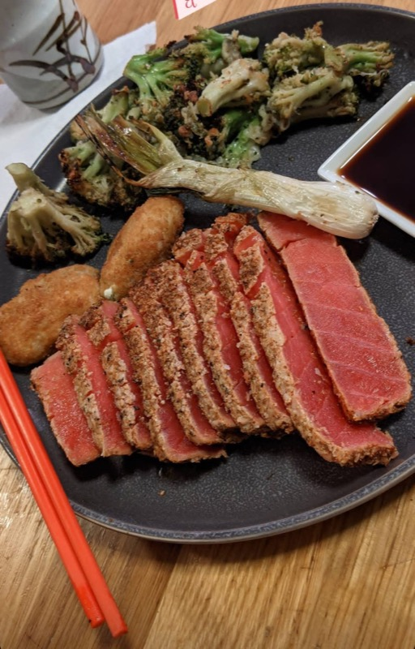

## 土木工学、建設、エネルギー

メキシコのモンテレイ工科大学で土木工学を学び、学年首席で卒業しました。在学中の夏にはSchlumbergerでフィールドエンジニア研修生として働き、卒業後の最初の仕事はモンテレイの建築設計事務所Saul Gonzalezでの現場監督でした。

2015年に来日し、東京大学で地震工学の修士課程を始めました。2017年にシンガポール国立大学へ転学して海洋工学修士（石油工学専攻）を修了し、在学中にはINTECSEAで海洋パイプラインのインターンを経験しました。

2018年から2020年まではサンフランシスコの建設業界で働き、Build Groupでプロジェクトエンジニア、その後Guzman Construction Groupでシニアプロジェクトエンジニアを務めました。

## ソフトウェアへの転身

建設業界を離れた後、ソフトウェアエンジニアとして学び直しました。2021年にNuCampの22週間のフルスタックWeb・モバイル開発ブートキャンプ（MongoDB、Express、React、Node.js、React Native）を修了し、2022年には同校のSQL・データ構造とアルゴリズム（Python）のコースを修了しました。

2022年11月にJPMorgan Chaseにソフトウェアエンジニアとして入社しました。3年間、JavaとSpring Bootでバックエンドサービスを開発し、そのAWSインフラをTerraformで管理しながら、CI/CDと可観測性にも取り組みました。2026年にはChefiniを創業して一貫して開発し、ETHGlobal Tokyo 2026ではSapore Payを開発しました。

現在は日本を拠点にしています。

## 興味・関心

スペイン語（母語）と英語を話し、日本語を勉強中です（JLPT N4）。メキシコ、日本、シンガポール、米国に住んだことがあります。料理も好きです。

